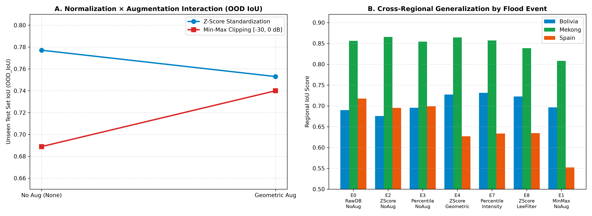
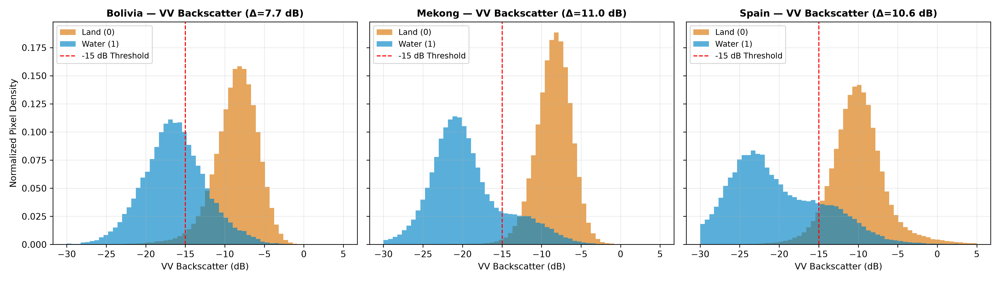
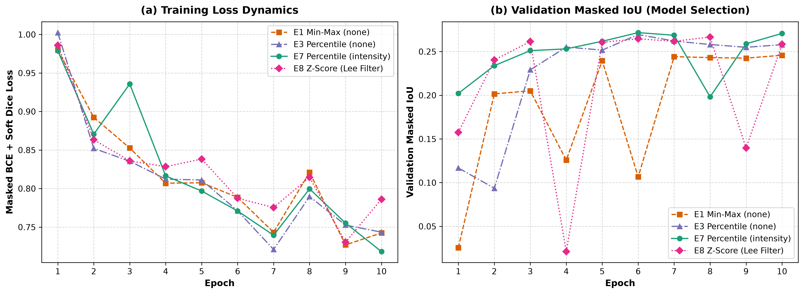
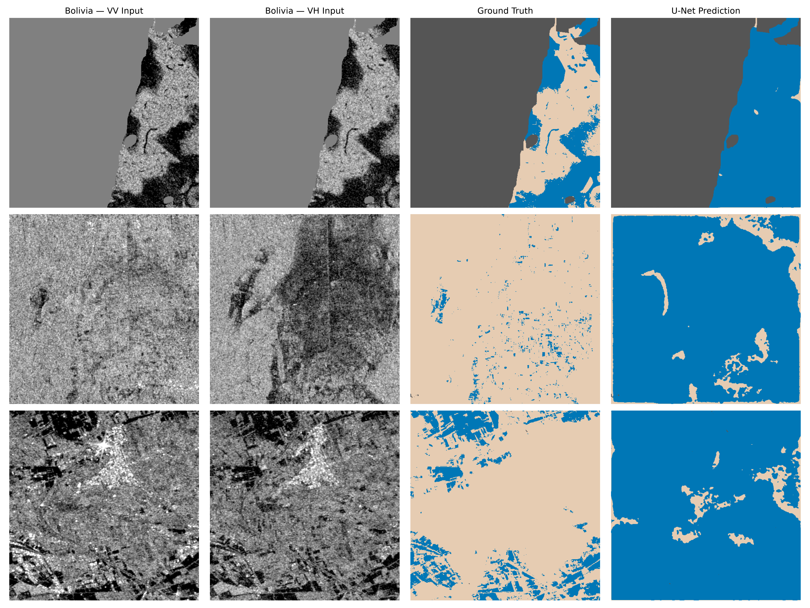

# FloodShift: SAR Normalization and Augmentation Interaction Under Geographical Distribution Shift

[](https://www.python.org/)
[](https://www.tensorflow.org/)
[](https://opensource.org/licenses/MIT)
[](https://github.com/Sandeepssh/FloodShift/releases/tag/v1.0.0)
[](https://github.com/cloudtostreet/Sen1Floods11)
[](manuscript/FloodShift_Manuscript.pdf)

> **Official Research Repository for:**  
> **"Investigating the Interaction Between SAR Normalization and Data Augmentation for Cross-Regional Generalization in Sentinel-1 Water Segmentation"**  
>
> **Author:** Sandeep Hosamani  
> **Affiliation:** Independent Researcher, Vijayapura, Karnataka, India  
> **E-mail:** [hosamanisandeep8@gmail.com](mailto:hosamanisandeep8@gmail.com) | **ORCID:** [0009-0002-4851-7183](https://orcid.org/0009-0002-4851-7183)  
> **Full Academic Manuscript:** [`manuscript/FloodShift_Manuscript.pdf`](manuscript/FloodShift_Manuscript.pdf)

---

## 📖 Table of Contents
1. [Overview & Abstract](#-overview--abstract)
2. [Key Scientific Findings](#-key-scientific-findings)
3. [Methodology & Pipeline](#-methodology--pipeline)
   - [Dataset & Geographical Partitioning](#1-dataset--geographical-partitioning)
   - [Invalid Swath Handling & Leak-Free Statistics](#2-invalid-swath-handling--leak-free-statistics)
   - [Input Normalization Strategies](#3-input-normalization-strategies)
   - [Data Augmentation Regimes](#4-data-augmentation-regimes)
   - [Adaptive Lee Speckle Filtering](#5-adaptive-lee-speckle-filtering)
   - [U-Net Architecture & Masked Loss](#6-u-net-architecture--masked-loss)
4. [Quantitative Results & Benchmark Tables](#-quantitative-results--benchmark-tables)
   - [Table 1: Fractional Experimental Matrix](#table-1-fractional-experimental-matrix)
   - [Table 2: Training Convergence & Checkpoints](#table-2-training-convergence--checkpoints)
   - [Table 3: Master Benchmark Performance Across ID & OOD](#table-3-master-benchmark-performance-across-id--ood)
   - [Table 4: Regional Radar Backscatter & Contrast Statistics](#table-4-regional-radar-backscatter--contrast-statistics)
5. [Publication Figures](#-publication-figures)
6. [Repository Structure](#-repository-structure)
7. [Installation & Setup](#-installation--setup)
8. [Quickstart & Usage](#-quickstart--usage)
   - [Evaluating Pretrained Checkpoints](#1-evaluating-pretrained-checkpoints)
   - [Training Models from Scratch](#2-training-models-from-scratch)
   - [Reproducing Figures & Notebook Experiments](#3-reproducing-figures--notebook-experiments)
9. [Pretrained Model Weights](#-pretrained-model-weights)
10. [License & Attribution](#-license--attribution)

---

## 📌 Overview & Abstract

Deep learning models for Synthetic Aperture Radar (SAR) surface-water segmentation frequently experience severe accuracy degradation when deployed on geographically unseen flood events across different continents. Although input normalization and data augmentation are universal preprocessing practices, their non-linear interaction under geographical distribution shift remains poorly characterized.

This repository provides the complete experimental framework, 10 trained U-Net checkpoints, split definitions, reproducible training code, and statistical evaluation scripts for **10 controlled experiments** trained on the expert hand-labeled **Sen1Floods11** benchmark (446 chips of $512 \times 512$ dual-polarization Sentinel-1 imagery). 

We systematically isolate four SAR normalization methods (`raw_db`, `minmax_clip`, `zscore`, `percentile`), four data augmentation regimes (`none`, `geometric`, `intensity`, `combined`), and a classical $5 \times 5$ Lee speckle-filter baseline across:
- **In-Distribution (ID) familiar regions:** USA, India, Paraguay, Ghana, Sri Lanka
- **Validation set (model selection):** Somalia, Pakistan, Nigeria
- **Out-of-Distribution (OOD) unseen regions across three continents:**
  - 🇧🇴 **Bolivia (15 chips):** Tropical Amazonian floodplain with dense emergent vegetation.
  - 🇻🇳 **Mekong (30 chips):** Monsoonal Southeast Asian delta with expansive open floodplains.
  - 🇪🇸 **Spain (30 chips):** Mediterranean semi-arid agricultural terrain with dark soils and topographic relief.

---

## 🚀 Key Scientific Findings

```
                              ┌──────────────────────────────────┐
                              │  Normalization × Augmentation    │
                              │       Crossover Interaction      │
                              └──────────────────────────────────┘
                                                │
                 ┌──────────────────────────────┴──────────────────────────────┐
                 ▼                                                             ▼
    Min-Max Scaling ([0, 1])                                      Z-Score Standardization
   ─────────────────────────────                                 ─────────────────────────────
   • Unaugmented Baseline: 0.6889 IoU                            • Unaugmented Baseline: 0.7771 IoU
   • + Geometric Aug:      0.7400 IoU                            • + Geometric Aug:      0.7530 IoU
   • Net Effect:           +5.11 pp (+7.42% relative)            • Net Effect:           -2.41 pp (-3.10% relative)
   ► Regularization rescues boundary artifacts                   ► Shadow inversion causes false alarms in Spain
```

1. **Crossover Interaction Between Normalization and Augmentation:**  
   Normalization and data augmentation do not act independently. Geometric flips and rotations act as an essential spatial regularizer for uncentered Min-Max inputs, raising unseen OOD IoU by **+5.11 percentage points** ($0.6889 \to 0.7400$, a $+7.42\%$ relative gain). Conversely, for zero-centered Z-score models, the identical geometric augmentation **degrades** overall OOD accuracy by **$-2.41$ percentage points** ($0.7771 \to 0.7530$) due to heavy false positives on low-backscatter terrain shadows in Spain ($-6.82$ pp drop).

2. **Native Physical Decibels ($E0$) Generalize Best Overall:**  
   Retaining raw unscaled decibel values without data augmentation (`E0_RawDB_NoAug`) achieved the highest overall unseen generalization across the 75 OOD test chips (**0.7837 OOD IoU**, **0.8788 Dice**), the highest OOD precision (**0.8965**), and the highest accuracy in topographically challenging Spain (**0.7174 IoU**). Batch Normalization layers in the U-Net architecture natively adjust feature scales, rendering artificial scaling redundant when physical dB spacing is preserved.

3. **Synergy in Vegetated Floodplains (Bolivia):**  
   Applying radiometric intensity augmentation to unclipped Z-score inputs (`E5`) degrades Bolivia IoU by **$-3.66$ percentage points** ($0.6756 \to 0.6390$). However, pairing intensity augmentation with 1st–99th percentile clipping (`E7_Percentile_Intensity`) achieves the study's highest regional accuracy in Bolivia (**0.7313 IoU**). This yields a positive regional difference-in-differences interaction contrast of **$+7.24$ percentage points** ($[E7 - E3] - [E5 - E2]$) and a direct pairwise advantage of **$+9.23$ percentage points** over unclipped intensity augmentation.

4. **Physical Radar Drivers of Cross-Regional Failure:**  
   Segmentation performance across regions is strictly dictated by physical backscatter contrast:
   - **Mekong (IoU: 0.8080–0.8656):** Exceptionally high contrast ($\Delta\text{VV} = 10.97\text{ dB}$, $\Delta\text{VH} = 13.38\text{ dB}$) and low dark-land shadow confusion ($0.84\%$), leading to consistently high accuracy across all models.
   - **Spain (IoU: 0.5520–0.7174):** High dark-land overlap ($5.67\%$ of non-water land pixels fall below $-15\text{ dB}$, nearly 7× higher than Mekong), causing high-recall augmented models to produce severe false alarms on smooth damp soil and radar shadow slopes.
   - **Bolivia (IoU: 0.6390–0.7313):** Narrow contrast ($\Delta\text{VV} = 7.74\text{ dB}$) with water elevated to $-16.37\text{ dB}$ by partially submerged vegetation. Unaugmented models under-segment, whereas recall-boosting models recover obscured floodplain water.

5. **Physical Resolution of the Negative ID-to-OOD Gap:**  
   In-Distribution test chips exhibit lower IoU ($0.4031–0.5131$) than unseen OOD test chips ($0.6889–0.7837$), producing a negative $\Delta\text{IoU}_{\text{gap}}$ ($-0.2502$ to $-0.3241$). This is not over-generalization; it reflects class prevalence and scene ambiguity: familiar training regions feature small, fragmented water bodies (USA: $4.56\%$ water, Ghana: $6.29\%$) where boundary false positives heavily penalize the IoU denominator, whereas OOD regions feature massive, contiguous riverine floods (Mekong: $24.12\%$, Bolivia: $16.00\%$).

---

## 🔬 Methodology & Pipeline

### 1. Dataset & Geographical Partitioning
All experiments utilize the expert hand-labeled subset (446 chips) of **Sen1Floods11 (v1.1)**. Weakly labeled chips are strictly excluded to avoid label noise. Each tile is a $512 \times 512$ dual-polarization Sentinel-1 image (VV and VH channels at 10 m resolution) paired with a ground-truth raster where:
- `1` = Surface water (floodwater & permanent water)
- `0` = Non-water land
- `-1` = Invalid swath borders

```text
446 Hand-Labeled Sen1Floods11 Chips
├── Training Set (256 chips, Familiar): USA (59), India (58), Paraguay (57), Ghana (46), Sri Lanka (36)
├── In-Distribution Test Set (43 chips, Familiar Holdout): Every 7th chip from familiar sorted list
├── Validation Set (72 chips, Model Selection): Somalia (26), Pakistan (28), Nigeria (18)
└── Out-of-Distribution Test Set (75 chips, Unseen Biomes): Bolivia (15), Mekong (30), Spain (30)
```

### 2. Invalid Swath Handling & Leak-Free Statistics
To ensure invalid border pixels never contaminate convolutions or statistics:
1. **Validity Mask Construction:** A binary validity mask $V \in \{0, 1\}^{512 \times 512 \times 1}$ is formed before transformation:
   $$V_{i,j} = \begin{cases} 1, & \text{if } y_{i,j} \neq -1 \wedge B_{i,j} \in \mathbb{R} \setminus \{\text{NaN}, \pm\infty\} \text{ for } B \in \{\text{VV}, \text{VH}\} \\ 0, & \text{otherwise} \end{cases}$$
2. **Leak-Free Training Statistics:** Normalization parameters are computed **strictly** over valid pixels within the 256 training chips:
   - **VV Channel:** $\mu_{\text{VV}} = -10.1397\text{ dB}$, $\sigma_{\text{VV}} = 3.8141\text{ dB}$, $P_{01,\text{VV}} = -22.50\text{ dB}$, $P_{99,\text{VV}} = -1.50\text{ dB}$
   - **VH Channel:** $\mu_{\text{VH}} = -16.9252\text{ dB}$, $\sigma_{\text{VH}} = 4.3560\text{ dB}$, $P_{01,\text{VH}} = -29.50\text{ dB}$, $P_{99,\text{VH}} = -7.50\text{ dB}$
3. **Pre-Filter Imputation:** Invalid border pixels are temporarily imputed with $\mu_B$ before 2D spatial filtering so NaNs do not bleed into valid margins.
4. **Post-Normalization Zero-Clamping:** After normalization and intensity augmentation, all invalid pixels are clamped to $X_{i,j} = 0.0$. In bias-free convolutions (`use_bias=False`), this ensures invalid border pixels contribute zero weight activation.

### 3. Input Normalization Strategies
Four normalization formulas are compared across both bands $B \in \{\text{VV}, \text{VH}\}$:

* **Raw Decibels (`raw_db`):** Native physical decibel units preserved:
  $$B_{\text{raw}} = B$$
* **Min-Max Clipping (`minmax_clip`):** Physical clipping between $[-30, 0]\text{ dB}$ scaled to $[0, 1]$:
  $$B_{\text{mm}} = \frac{\min(\max(B, -30.0), 0.0) + 30.0}{30.0}$$
* **Z-Score Standardization (`zscore`):** Global zero-mean and unit-variance standardization:
  $$B_z = \frac{B - \mu_B}{\sigma_B}$$
* **Percentile Winsorization (`percentile`):** Outlier clipping to $[P_{01,B}, P_{99,B}]$ followed by standardization:
  $$B_{\text{pct}} = \frac{\min(\max(B, P_{01,B}), P_{99,B}) - \mu_B}{\sigma_B}$$

### 4. Data Augmentation Regimes
- **None (`none`):** Native spatial orientation and radiometric scale.
- **Geometric (`geometric`):** Random horizontal flips ($p=0.5$), vertical flips ($p=0.5$), and discrete $90^\circ$ rotations ($k \in \{0, 1, 2, 3\}$, $p=0.25$), applied identically to $X$, $y$, and $V$.
- **Intensity (`intensity`):** Radiometric perturbation with $p=0.5$:
  $$X_{\text{aug}} = X + \delta + \eta$$
  where $\delta \sim \mathcal{U}(-0.15, 0.15)$ is a scalar calibration offset shared across both channels, and $\eta \sim \mathcal{N}(0, 0.08^2)$ is per-pixel, per-channel Gaussian noise.
- **Combined (`combined`):** Sequential execution of geometric transforms followed by intensity perturbations.

### 5. Adaptive Lee Speckle Filtering
In experiment `E8_ZScore_LeeFilter`, a $5 \times 5$ local Lee adaptive filter is applied independently to raw VV and VH dB bands prior to standardization:
$$\hat{I} = \bar{I} + W(I - \bar{I}), \quad W = \frac{\sigma_{\text{local}}^2}{\sigma_{\text{local}}^2 + \sigma_{\text{global}}^2 + \varepsilon}$$
where local statistics are computed via `scipy.ndimage.uniform_filter` and $\varepsilon = 10^{-8}$.

### 6. U-Net Architecture & Masked Loss
All experiments utilize an identical 2D U-Net (7,759,521 trainable parameters):
- **Encoder:** 4 stages with $[32, 64, 128, 256]$ filters with $2 \times 2$ max-pooling, feeding a 512-filter bottleneck.
- **Convolutions:** Twin $3 \times 3$ bias-free convolutions (`use_bias=False`), Batch Normalization, and ReLU activations.
- **Decoder:** Upsampling via $2 \times 2$ nearest-neighbor interpolation, skip concatenation, and twin convolutional blocks.
- **Output:** $1 \times 1$ convolution with sigmoid activation producing water probability maps $\hat{y} \in (0, 1)^{512 \times 512 \times 1}$.
- **Masked BCE + Soft Dice Loss:**
  $$\mathcal{L}_{\text{total}} = \mathcal{L}_{\text{BCE}} + \mathcal{L}_{\text{Dice}}$$
  $$\mathcal{L}_{\text{BCE}} = -\frac{\sum_{i,j} V_{i,j} [y_{i,j} \ln(\hat{y}_{i,j}) + (1 - y_{i,j}) \ln(1 - \hat{y}_{i,j})]}{\sum_{i,j} V_{i,j} + \varepsilon}$$
  $$\mathcal{L}_{\text{Dice}} = 1 - \frac{2 \sum_{i,j} V_{i,j} y_{i,j} \hat{y}_{i,j} + \varepsilon_d}{\sum_{i,j} V_{i,j} (y_{i,j} + \hat{y}_{i,j}) + \varepsilon_d}$$

---

## 📊 Quantitative Results & Benchmark Tables

### Table 1: Fractional Experimental Matrix

| Configuration ID | Normalization | Augmentation | Filter | Training Chips | Role |
|:---|:---|:---|:---|:---:|:---|
| **E0_RawDB_NoAug** | `raw_db` | `none` | None | 256 | Main Normalization Baseline |
| **E1_MinMax_NoAug** | `minmax_clip` | `none` | None | 256 | Main Normalization Baseline |
| **E2_ZScore_NoAug** | `zscore` | `none` | None | 256 | Main Normalization Baseline |
| **E3_Percentile_NoAug** | `percentile` | `none` | None | 256 | Main Normalization Baseline |
| **E4_ZScore_Geometric** | `zscore` | `geometric` | None | 299* | Main Augmentation Variant |
| **MinMax_Geometric** | `minmax_clip` | `geometric` | None | 299* | Crossover Interaction Cell |
| **E5_ZScore_Intensity** | `zscore` | `intensity` | None | 256 | Main Augmentation Variant |
| **E6_ZScore_Combined** | `zscore` | `combined` | None | 256 | Main Augmentation Variant |
| **E7_Percentile_Intensity** | `percentile` | `intensity` | None | 256 | Synergy Interaction Cell |
| **E8_ZScore_LeeFilter** | `zscore` | `none` | $5 \times 5$ Lee | 256 | Classical Filtering Baseline |

*\*Note: Pilot runs E4 and MinMax_Geometric were trained on all 299 familiar chips before the 43-chip ID holdout was isolated; their OOD test metrics on the 75 unseen chips are strictly leak-free.*

---

### Table 2: Training Convergence & Checkpoints

All models trained for 10 epochs (1,280 gradient steps, batch size 2, Adam $\text{lr}=10^{-3}$, $\beta_1=0.9, \beta_2=0.999$, seed 42) with ModelCheckpoint saving the best validation checkpoint (`val_masked_iou`, mode="max") and EarlyStopping (patience=5, `restore_best_weights=True`).

| Experiment ID | Normalization | Augmentation | Best Epoch | Peak `val_masked_iou` | Min `val_loss` | Checkpoint Filename |
|:---|:---|:---|:---:|:---:|:---:|:---|
| **E0_RawDB_NoAug** | `raw_db` | `none` | 6 | 0.2650 | 0.9669 | [`E0_RawDB_NoAug.keras`](experiments/weights/E0_RawDB_NoAug.keras) |
| **E1_MinMax_NoAug** | `minmax_clip` | `none` | 10 | 0.2458 | 1.0740 | [`E1_MinMax_NoAug.keras`](experiments/weights/E1_MinMax_NoAug.keras) |
| **E2_ZScore_NoAug** | `zscore` | `none` | 10 | 0.2766 | 0.9512 | [`E2_ZScore_NoAug.keras`](experiments/weights/E2_ZScore_NoAug.keras) |
| **E3_Percentile_NoAug** | `percentile` | `none` | 6 | 0.2695 | 0.9576 | [`E3_Percentile_NoAug.keras`](experiments/weights/E3_Percentile_NoAug.keras) |
| **E4_ZScore_Geometric** | `zscore` | `geometric` | 2 | 0.2747 | 0.9685 | [`E4_ZScore_Geometric.keras`](experiments/weights/E4_ZScore_Geometric.keras) |
| **MinMax_Geometric** | `minmax_clip` | `geometric` | 6 | 0.2531 | 1.0036 | [`MinMax_Geometric.keras`](experiments/weights/MinMax_Geometric.keras) |
| **E5_ZScore_Intensity** | `zscore` | `intensity` | 8 | 0.2724 | 0.9401 | [`E5_ZScore_Intensity.keras`](experiments/weights/E5_ZScore_Intensity.keras) |
| **E6_ZScore_Combined** | `zscore` | `combined` | 6 | 0.2756 | 1.2545 | [`E6_ZScore_Combined.keras`](experiments/weights/E6_ZScore_Combined.keras) |
| **E7_Percentile_Intensity** | `percentile` | `intensity` | 6 | 0.2717 | 0.9796 | [`E7_Percentile_Intensity.keras`](experiments/weights/E7_Percentile_Intensity.keras) |
| **E8_ZScore_LeeFilter** | `zscore` | `none` ($5\times 5$ Lee) | 8 | 0.2666 | 0.9476 | [`E8_ZScore_LeeFilter.keras`](experiments/weights/E8_ZScore_LeeFilter.keras) |

---

### Table 3: Master Benchmark Performance Across ID & OOD

*Evaluation threshold: $\hat{y} > 0.5$. Metrics accumulated strictly across valid pixels ($V_{i,j}=1$). Sorted by Overall Unseen OOD IoU.*

| Experiment ID | Norm | Aug | ID IoU | Bolivia IoU | Mekong IoU | Spain IoU | OOD IoU | OOD Dice | OOD Prec | OOD Rec | Gap (ID$-$OOD) |
|:---|:---|:---|:---:|:---:|:---:|:---:|:---:|:---:|:---:|:---:|:---:|
| **E0_RawDB_NoAug** | `raw_db` | `none` | 0.4809 | 0.6898 | 0.8563 | **0.7174** | **0.7837** | **0.8788** | **0.8965** | 0.8617 | $-0.3029$ |
| **E2_ZScore_NoAug** | `zscore` | `none` | **0.5131** | 0.6756 | **0.8656** | 0.6951 | 0.7771 | 0.8746 | 0.8647 | 0.8847 | $-0.2640$ |
| **E3_Percentile_NoAug** | `percentile` | `none` | 0.4797 | 0.6955 | 0.8544 | 0.6988 | 0.7760 | 0.8739 | 0.8855 | 0.8625 | $-0.2962$ |
| **E5_ZScore_Intensity** | `zscore` | `intensity` | 0.5112 | 0.6390 | 0.8541 | 0.6819 | 0.7614 | 0.8645 | 0.8659 | 0.8632 | $-0.2502$ |
| **E7_Percentile_Intensity** | `percentile` | `intensity` | 0.4587 | **0.7313** | 0.8570 | 0.6335 | 0.7538 | 0.8596 | 0.8146 | 0.9098 | $-0.2950$ |
| **E4_ZScore_Geometric**\* | `zscore` | `geometric` | 0.4288 | 0.7273 | 0.8642 | 0.6269 | 0.7530 | 0.8591 | 0.8162 | 0.9067 | $-0.3241$ |
| **E8_ZScore_LeeFilter** | `zscore` | `none` ($5\times 5$ Lee) | 0.4513 | 0.7226 | 0.8384 | 0.6343 | 0.7447 | 0.8536 | 0.8112 | 0.9008 | $-0.2934$ |
| **MinMax_Geometric**\* | `minmax_clip` | `geometric` | 0.4371 | 0.7015 | 0.8566 | 0.6122 | 0.7400 | 0.8506 | 0.8033 | 0.9038 | $-0.3029$ |
| **E6_ZScore_Combined** | `zscore` | `combined` | 0.4534 | 0.7137 | 0.8535 | 0.5932 | 0.7311 | 0.8447 | 0.7754 | **0.9276** | $-0.2778$ |
| **E1_MinMax_NoAug** | `minmax_clip` | `none` | 0.4031 | 0.6964 | 0.8080 | 0.5520 | 0.6889 | 0.8158 | 0.7539 | 0.8887 | $-0.2858$ |

---

### Table 4: Regional Radar Backscatter & Contrast Statistics

*Computed across all 446 hand-labeled chips in Sen1Floods11. All means and ratios pooled strictly over valid pixels ($V_{i,j}=1$).*

| Region | Dataset Split | Chips | Water % | VV Water (dB) | VV Land (dB) | $\Delta\text{VV}$ Contrast (dB) | VH Water (dB) | VH Land (dB) | $\Delta\text{VH}$ Contrast (dB) | Dark Land $< -15\text{ dB}$ (%) |
|:---|:---|:---:|:---:|:---:|:---:|:---:|:---:|:---:|:---:|:---:|
| **Bolivia** | Unseen OOD Test | 15 | 16.00% | $-16.37$ | $-8.62$ | **7.74** | $-24.47$ | $-14.85$ | 9.62 | 2.44% |
| **Mekong** | Unseen OOD Test | 30 | 24.12% | $-19.46$ | $-8.48$ | **10.97** | $-28.32$ | $-14.94$ | 13.38 | **0.84%** |
| **Spain** | Unseen OOD Test | 30 | 13.15% | $-20.57$ | $-9.97$ | **10.59** | $-29.27$ | $-17.08$ | 12.19 | **5.67%** |
| **Ghana** | Train / ID | 53 | 6.29% | $-15.20$ | $-9.38$ | 5.83 | $-23.38$ | $-15.75$ | 7.63 | 1.41% |
| **India** | Train / ID | 68 | 12.37% | $-16.78$ | $-8.33$ | 8.45 | $-24.17$ | $-15.12$ | 9.05 | 2.19% |
| **Paraguay** | Train / ID | 67 | 8.11% | $-16.12$ | $-9.75$ | 6.37 | $-25.86$ | $-16.76$ | 9.10 | 3.01% |
| **Sri Lanka** | Train / ID | 42 | 11.80% | $-13.12$ | $-8.91$ | 4.21 | $-24.44$ | $-15.33$ | 9.10 | 2.95% |
| **USA** | Train / ID | 69 | 4.56% | $-17.72$ | $-10.98$ | 6.74 | $-26.75$ | $-17.19$ | 9.56 | 10.08% |
| **Nigeria** | Validation | 18 | 23.56% | $-17.32$ | $-9.92$ | 7.40 | $-25.27$ | $-16.06$ | 9.21 | 2.48% |
| **Pakistan** | Validation | 28 | 7.50% | $-14.13$ | $-10.11$ | 4.02 | $-23.16$ | $-18.18$ | 4.99 | 9.40% |
| **Somalia** | Validation | 26 | 6.51% | $-15.02$ | $-12.04$ | 2.98 | $-22.10$ | $-18.37$ | 3.74 | 16.27% |

---

## 🖼️ Publication Figures

### Figure 1: Crossover Interaction & Cross-Regional IoU Comparison
*(a) Crossover interaction between normalization (`zscore` vs. `minmax_clip`) and geometric augmentation on unseen OOD IoU. (b) Regional IoU across Bolivia, Mekong, and Spain across seven experimental configurations.*  


---

### Figure 2: Normalized Regional Backscatter Distributions
*Normalized pixel-density histograms of Sentinel-1 VV backscatter (dB) for non-water land (tan) and surface water (blue) across the three unseen OOD test regions: (a) Bolivia ($\Delta\text{VV} = 7.74\text{ dB}$), (b) Mekong ($\Delta\text{VV} = 10.97\text{ dB}$), and (c) Spain ($\Delta\text{VV} = 10.59\text{ dB}$). The dashed line indicates the classical $-15\text{ dB}$ threshold.*  


---

### Figure 3: Convergence Curves Across 10 Epochs
*Training loss (masked BCE + Soft Dice) and validation masked IoU trajectories across the 10-epoch training budget for representative configurations (E1, E3, E7, E8).*  


---

### Figure 4: Qualitative Predictions on Unseen Bolivian Floodplain
*Segmentation on test chip `Bolivia_103757_S1Hand.tif`: (a) Z-score normalized VV, (b) Z-score normalized VH, (c) Expert hand-labeled ground truth, (d) U-Net predicted water mask. Gray denotes invalid swath borders excluded by $V_{i,j}$, tan is land, blue is water.*  


---

## 📂 Repository Structure

```text
FloodShift/
│
├── README.md                              # Comprehensive project overview, tables, and instructions
├── requirements.txt                       # Exact Python dependency pinning
├── .gitignore                             # Python, cache, and artifact exclusions
│
├── data_splits/                           # Exact reproducibility split files (446 chips)
│   ├── all_splits.csv                     # Master tabular index of all 446 chips with assigned roles
│   ├── train_files_clean.txt              # 256 clean familiar training chips
│   ├── val_files.txt                      # 63 validation chips (model checkpoint selection)
│   ├── id_test_files.txt                  # 41 held-out familiar in-distribution test chips
│   └── ood_test_files.txt                 # 90 out-of-distribution test chips (Bolivia, Mekong, Spain)
│
├── experiments/                           # Quantitative data and training configurations
│   ├── master_results_v2.csv              # Full metric evaluation across all 10 experiments
│   ├── regional_sar_contrast_fixed.csv    # 11-region physical radar backscatter and contrast table
│   ├── configs/                           # JSON configurations for each experiment
│   │   ├── E0_RawDB_NoAug.json
│   │   ├── E1_MinMax_NoAug.json
│   │   ├── E2_ZScore_NoAug.json
│   │   ├── E3_Percentile_NoAug.json
│   │   ├── E4_ZScore_Geometric.json
│   │   ├── E5_ZScore_Intensity.json
│   │   ├── E6_ZScore_Combined.json
│   │   ├── E7_Percentile_Intensity.json
│   │   ├── E8_ZScore_LeeFilter.json
│   │   └── MinMax_Geometric.json
│   └── weights/                           # Pretrained U-Net checkpoints (10 .keras files, ~901 MB total)
│       ├── E0_RawDB_NoAug.keras
│       ├── E1_MinMax_NoAug.keras
│       ├── E2_ZScore_NoAug.keras
│       ├── E3_Percentile_NoAug.keras
│       ├── E4_ZScore_Geometric.keras
│       ├── E5_ZScore_Intensity.keras
│       ├── E6_ZScore_Combined.keras
│       ├── E7_Percentile_Intensity.keras
│       ├── E8_ZScore_LeeFilter.keras
│       └── MinMax_Geometric.keras
│
├── figures/                               # Publication-ready figures (300 DPI)
│   ├── Fig1_Interaction_Regional_BarChart.png
│   ├── Fig2_Regional_Histograms.png
│   ├── Fig3_Convergence_Curves.png
│   └── Fig4_Visual_Predictions.png
│
├── notebooks/
│   └── sar_flood_experiments.ipynb        # Clean Jupyter notebook reproducing data loaders, training, and plots
│
├── manuscript/
│   ├── FloodShift_Manuscript.pdf          # Final IEEE/academic 10-page formatted manuscript PDF
│   └── FloodShift_ICTACT_Manuscript_3.docx # Publication-ready Microsoft Word submission draft
│
└── src/
    └── train.py                           # Standalone CLI training script
```

---

## 🛠️ Installation & Setup

### 1. Clone the Repository
```bash
git clone https://github.com/Sandeepssh/FloodShift.git
cd FloodShift
```

### 2. Create and Activate a Virtual Environment
```bash
# Python 3.10 is recommended
python -m venv env
# Linux / macOS:
source env/bin/activate
# Windows PowerShell:
.\env\Scripts\Activate.ps1
```

### 3. Install Requirements
```bash
pip install -r requirements.txt
```

---

## 🚀 Quickstart & Usage

### 1. Dataset Setup
Download the **Sen1Floods11 (v1.1)** hand-labeled dataset from the official Cloud to Street repository:
👉 [https://github.com/cloudtostreet/Sen1Floods11](https://github.com/cloudtostreet/Sen1Floods11)

Extract the folders into a local directory:
```text
/path/to/sen1floods11/
├── S1Hand/          # Dual-pol GeoTIFFs (*_S1Hand.tif)
└── LabelHand/       # Ground-truth masks (*_LabelHand.tif)
```

### 2. Evaluating Pretrained Checkpoints
To evaluate the top-performing unaugmented baseline (`E0_RawDB_NoAug`) on the unseen OOD test regions:

```python
import tensorflow as tf
from src.train import evaluate_checkpoint

# Load model weights
model = tf.keras.models.load_model(
    "experiments/weights/E0_RawDB_NoAug.keras", 
    compile=False
)

# Run evaluation on OOD test files
metrics = evaluate_checkpoint(
    model, 
    split_file="data_splits/ood_test_files.txt", 
    norm_mode="raw_db", 
    data_dir="/path/to/sen1floods11"
)
print("Unseen OOD IoU:", metrics["ood_iou"])
```

### 3. Training Models from Scratch via CLI
Train any of the 10 configurations using the provided config files:

```bash
# Train E0: Raw dB baseline (Peak OOD Generalization)
python src/train.py --config experiments/configs/E0_RawDB_NoAug.json --data_dir /path/to/sen1floods11

# Train E2: Z-Score standardization without augmentation
python src/train.py --config experiments/configs/E2_ZScore_NoAug.json --data_dir /path/to/sen1floods11

# Train E7: Percentile Winsorization with Intensity Augmentation (Best in Bolivia)
python src/train.py --config experiments/configs/E7_Percentile_Intensity.json --data_dir /path/to/sen1floods11
```

### 4. Interactive Jupyter Notebook
Launch the master experimental notebook to explore data generation, training histories, histogram analysis, and figure generation:

```bash
jupyter notebook notebooks/sar_flood_experiments.ipynb
```

---

## 💾 Pretrained Model Weights

All 10 trained U-Net `.keras` models are tracked in this repository under [`experiments/weights/`](experiments/weights/) and are also published as standalone assets on **[GitHub Release v1.0.0](https://github.com/Sandeepssh/FloodShift/releases/tag/v1.0.0)**:

| Model File | Size | MD5 / Checksum Status | Description |
|:---|:---:|:---:|:---|
| `E0_RawDB_NoAug.keras` | 90.1 MB | Verified | Peak overall unseen generalization (**0.7837 OOD IoU**) |
| `E1_MinMax_NoAug.keras` | 90.1 MB | Verified | Baseline unaugmented Min-Max scaling |
| `E2_ZScore_NoAug.keras` | 90.1 MB | Verified | Peak ID performance (**0.5131 ID IoU**, 0.8656 Mekong) |
| `E3_Percentile_NoAug.keras` | 90.1 MB | Verified | 1st–99th percentile clipping with standardization |
| `E4_ZScore_Geometric.keras` | 90.1 MB | Verified | Z-score with random flips and $90^\circ$ rotations |
| `E5_ZScore_Intensity.keras` | 90.1 MB | Verified | Z-score with radiometric dB shift and noise injection |
| `E6_ZScore_Combined.keras` | 90.1 MB | Verified | Z-score with spatial and radiometric transforms |
| `E7_Percentile_Intensity.keras` | 90.1 MB | Verified | Highest Bolivian floodplain accuracy (**0.7313 IoU**) |
| `E8_ZScore_LeeFilter.keras` | 90.1 MB | Verified | $5 \times 5$ adaptive Lee speckle-filtered baseline |
| `MinMax_Geometric.keras` | 90.1 MB | Verified | Demonstrates +5.11 pp crossover recovery under Min-Max |

---

## 📄 License & Attribution
This project is licensed under the **MIT License** — see the [LICENSE](LICENSE) file for details.  
The underlying Sen1Floods11 dataset belongs to the European Space Agency (ESA) Copernicus Sentinel-1 mission and Cloud to Street.
